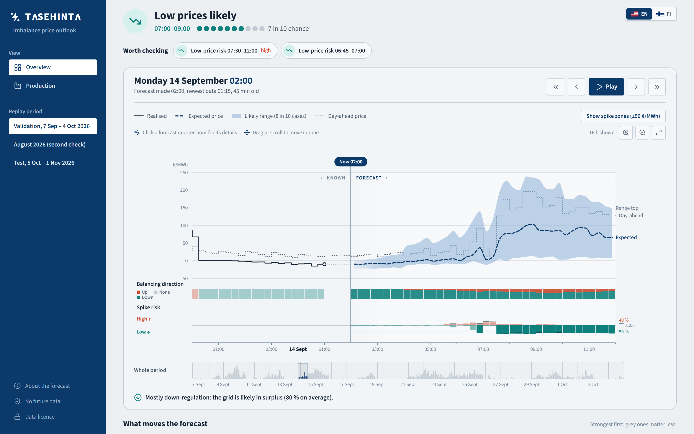
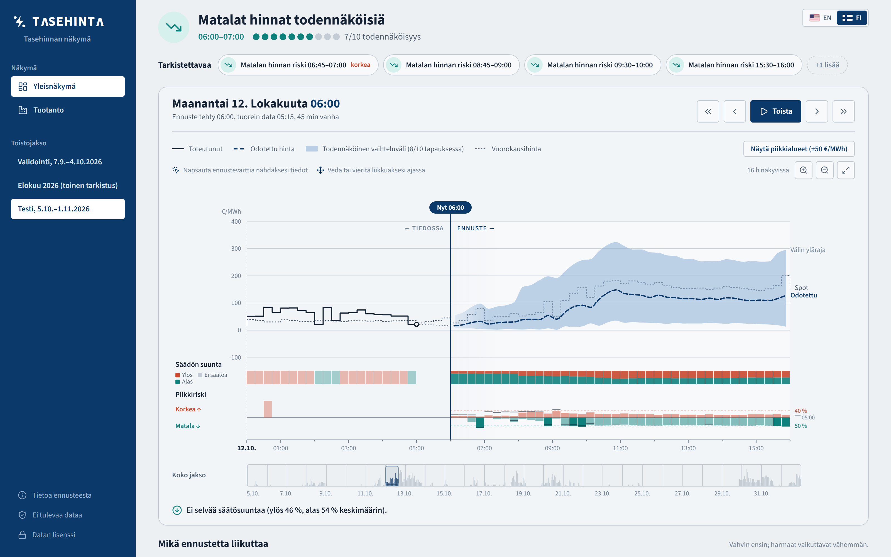
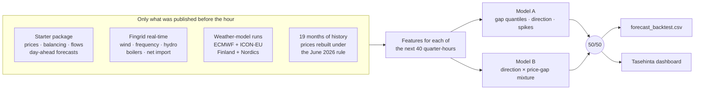

<div align="center">


### Know when the imbalance price will break away from spot, and why, before it happens.

**Since AI 2026 · Turku Energia challenge** · Turku, 6–8 November 2026

<a href="https://tasehinta.lovable.app"></a>
<a href="#-demo-video"></a>


-0B3C6A)


<br/>


[**The problem**](#-the-problem) · [**Dashboard**](#%EF%B8%8F-the-dashboard) · [**Results**](#-results) · [**How it works**](#-how-it-works) · [**Deliverables**](#-deliverables) · [**Run it**](#-run-it) · [**Team**](#-team)

</div>

<br/>

<p align="center">
  <a href="https://tasehinta.lovable.app"></a>
  <br/><sub><b>Overview, 14 Sep 02:00:</b> a low-price risk flagged for 07:30–12:00, the forecast with its 80 % range, the balancing direction and spike risk on one 15-minute axis, and the whole month on the slider below.</sub>
</p>

---

## ⚡ The problem

When a Turku Energia trader's position misses its plan, the difference is settled at the **imbalance price**. It's set every 15 minutes, and it can jump far above or below the day-ahead (spot) price when the Finnish grid runs short of power or into a surplus. A shortfall at the wrong quarter-hour can cost hundreds of euros per MWh.

**Tasehinta** ("imbalance price" in Finnish) looks 10 hours ahead, every full hour, and answers four questions for each of the next 40 quarter-hours:

| | |
|---|---|
| 💶 **What will the price be?** | A median forecast and an honest 80 % range around it |
| ↕️ **Which way will the grid be balanced?** | P(up-regulation), P(down-regulation), P(none) |
| ⚠️ **Will it spike?** | P(price > spot + 50 €/MWh) and P(price < spot − 50 €/MWh) |
| 🧭 **Why?** | The few factors that move the forecast most, strongest first |

Then it shows only what deserves attention, says what to check (never what to trade), and lets you replay any past hour exactly as it looked then.

## 🖥️ The dashboard

<table>
<tr>
<td width="50%" valign="top">

**🔎 Glance first, detail on demand.** One sentence for the next 10 hours, the few items worth checking, and one graph. Click any item or quarter-hour for its drivers and a suggestion.

**📈 One time axis.** Price and its range, balancing direction and spike risk (with the alert thresholds and the change since an hour ago) share the same 15-minute grid.

**⏪ Move through time.** Scroll, drag or use the slider, in 15-minute steps, across the validation, August and test months. Nothing published after "now" is ever shown.

**✅ Hindsight.** How the forecast did over the last day, week or month, scored only on prices published by then.

**🌍 English and Suomi**, switchable top right.

</td>
<td width="50%" valign="top">


<sub><b>Suomeksi, test month, 12 Oct 06:00:</b> several low-price risks flagged, with the realised prices on the left of "now".</sub>

</td>
</tr>
</table>

<p align="center"><a href="https://tasehinta.lovable.app"><b>▶ Open it: tasehinta.lovable.app</b></a></p>

## 📊 Results

The submitted forecast, scored with the organisers' own `score.py` (lower is better). Each month was forecast using only data published before it started.

<table>
<tr><th>Score (points)</th><th colspan="3">September · organisers' validation month</th><th colspan="3">August · our second check</th></tr>
<tr><td></td><td>Baseline</td><td><b>Tasehinta</b></td><td>Change</td><td>Baseline</td><td><b>Tasehinta</b></td><td>Change</td></tr>
<tr><td>Median error, MAE €/MWh (30)</td><td>66.20</td><td><b>40.19</b></td><td>−39 %</td><td>38.67</td><td><b>27.05</b></td><td>−30 %</td></tr>
<tr><td>Uncertainty, pinball P10/P90 (20)</td><td>24.18</td><td><b>11.07</b></td><td>−54 %</td><td>11.65</td><td><b>6.22</b></td><td>−47 %</td></tr>
<tr><td>Exceptional prices, spike Brier (20)</td><td>0.1132</td><td><b>0.0840</b></td><td>−26 %</td><td>0.0792</td><td><b>0.0648</b></td><td>−18 %</td></tr>
<tr><td>Balancing direction, Brier (10)</td><td>0.4509</td><td><b>0.3799</b></td><td>−16 %</td><td>0.4792</td><td><b>0.4202</b></td><td>−12 %</td></tr>
<tr><td><b>Weighted by the points</b></td><td></td><td colspan="2"><b>36.7 % better</b></td><td></td><td colspan="2"><b>29.0 % better</b></td></tr>
</table>

- 🗓️ **Better than the baseline in every week of September, on all four scores.**
- 🎯 **The 80 % range is honest:** it held the real price in 81 % of September's quarter-hours.
- 🧪 **Every change had to win both months.** Ideas that won only one (per-output blend weights, a third model, retuned trees, more features) were dropped.

## 🧠 How it works



1. **Forecast the gap, not the price.** The day-ahead price is known the afternoon before, so both models predict how far the imbalance price will land from it.
2. **Direction drives everything.** Short of power, the price jumps above spot; in surplus, it falls below. The models forecast direction and gap together, so price, range, direction and spike risk tell one consistent story.
3. **Two different models, averaged.** Built independently by two team members with different features and structures; their errors partly cancel.
4. **Strictly no hindsight.** Every input row is used only from its `first_usable_origin_utc`: real-time data 30 minutes after the quarter or later, weather runs 8 h (ECMWF) or 5 h (ICON-EU) after they start. Leakage tests guard it.
5. **What moves it most:** the spot level, the latest gap to spot, **wind in Sweden**, the expected error of the day-ahead wind forecast, and grid frequency in the first hour.

<details>
<summary><b>The two models in a little more detail</b></summary>

<br/>

| | Model A · Frank (`v7_rt`) | Model B · Abdo (`h_int4ss`) |
|---|---|---|
| Shape | Separate LightGBM models for hours 1–2 (real-time grid) and hours 3–10 (weather); the median from a twin that also sees Nordic wind | A mixture: P(up/down/none) × the price gap in each direction |
| Inputs | Package, Fingrid real-time, ECMWF + ICON-EU runs, Nordic wind, learned wind power, neighbour imbalance prices | Package, its own history features and volatility regimes |
| Calibration | Last 28 days before the cutoff: Platt scaling for probabilities, quantile offsets per horizon | Its own holdout calibration |
| Alone | 30.9 % better than the baseline | 32.4 % better |

Everything about the models (every feature, the settings, the drivers): [`model/README.md`](https://github.com/Rdog69/turku-energy-since-ai/blob/deliverables/model/README.md).

</details>

## 📦 Deliverables

Submitted through the Since AI platform by **Sunday 8 November, 10:00**. Requirements and their status: [submission checklist](https://github.com/Rdog69/turku-energy-since-ai/blob/brainstorming-frank/deliverables/README.md).

| | Deliverable | What it is |
|---|---|---|
| 📄 | [**Forecast file**](https://github.com/Rdog69/turku-energy-since-ai/blob/deliverables/forecast/README.md) | `forecast_backtest.csv`: 673 hourly forecasts × 40 quarter-hours for 5 Oct – 1 Nov 2026. Passes the organisers' validator with 0 errors and 0 warnings |
| 📝 | [**Evaluation report**](https://github.com/Rdog69/turku-energy-since-ai/blob/deliverables/report/evaluation_report.md) | The reasoning chain, the factors behind the forecast, and the validation results |
| 🧠 | [**Model description**](https://github.com/Rdog69/turku-energy-since-ai/blob/deliverables/model/README.md) | How it works, the data, every feature, the settings, the drivers |
| 🔗 | [**Sources and licences**](https://github.com/Rdog69/turku-energy-since-ai/blob/deliverables/sources/SOURCES_AND_LICENCES.md) | Every data source, external service, model and software component, with its usage rights |
| 💻 | [**Code and run instructions**](https://github.com/Rdog69/turku-energy-since-ai/blob/deliverables/code/README.md) | Both models and the blend, step by step |
| 🖥️ | [**Dashboard**](https://tasehinta.lovable.app) | The situational view (Level 2), live; source in [`frontend/`](https://github.com/Rdog69/turku-energy-since-ai/tree/brainstorming-frank/frontend) |
| 🎬 | [**Demo video**](#-demo-video) | Five minutes: the forecast, its uncertainty, the alerts and the drivers |
| 📊 | [**Slides**](https://github.com/Rdog69/turku-energy-since-ai/blob/deliverables/slides/README.md) | 5–8 slides |

## 🎬 Demo video

<p align="center"><a href="media/tasehinta-demo.mp4"><b>▶ media/tasehinta-demo.mp4</b></a></p>

## 🚀 Run it

```bash
git clone https://github.com/Rdog69/turku-energy-since-ai.git && cd turku-energy-since-ai
git checkout brainstorming-frank
python -m venv .venv && . .venv/bin/activate        # Windows: .venv\Scripts\activate
pip install -r requirements.txt
python -m pytest                                    # leakage tests: must all pass
```

Unzip the organisers' starter package into `starter_package/`, then:

```bash
python -m src.backtest.run --model v7_rt --period test          # model A: the test-month forecast, validated
python -m src.backtest.run --model v7_rt --period validation    # model A on September, scored with score.py
python -I submissions/tools/blend_period.py . v7_rt test submissions/forecast_backtest_h_int4ss.csv final  # the 50/50 blend
```

The dashboard (Node 20.19+):

```bash
python frontend/scripts/build_data.py
cd frontend && npx -y pnpm@9.15.9 install --frozen-lockfile && npx -y pnpm@9.15.9 dev
```

Model B and the full run order: [`code/README.md`](https://github.com/Rdog69/turku-energy-since-ai/blob/deliverables/code/README.md).

<details>
<summary><b>Where things are</b></summary>

<br/>

| Branch | What's there |
|---|---|
| `master` | This page, the screenshots, the team scoreboard |
| [`deliverables`](https://github.com/Rdog69/turku-energy-since-ai/tree/deliverables) | Everything we submit: forecast, report, model description, sources, code guide |
| [`brainstorming-frank`](https://github.com/Rdog69/turku-energy-since-ai/tree/brainstorming-frank) | Model A (`src/`), the final forecast files and blend tools (`submissions/`), the dashboard (`frontend/`), the results log (`docs/RESULTS.md`) |
| [`brainstorming-abdo`](https://github.com/Rdog69/turku-energy-since-ai/tree/brainstorming-abdo) | Model B (`experiments/lab/`) and the history dataset |
| [`front-end`](https://github.com/Rdog69/turku-energy-since-ai/tree/front-end) | The dashboard's first version |

</details>

## 📜 Data and credits

- **Data:** the organisers' starter package (Fingrid, ENTSO-E, Nord Pool, calendar); Fingrid's open real-time API; ECMWF and DWD ICON-EU forecast runs via [Open-Meteo](https://open-meteo.com) (CC BY 4.0); OpenStreetMap wind turbines (ODbL); Elering's 2025 day-ahead prices. Full list with licences: [sources and licences](https://github.com/Rdog69/turku-energy-since-ai/blob/deliverables/sources/SOURCES_AND_LICENCES.md).
- **Software:** Python, pandas, LightGBM, React, Vite, Tailwind, shadcn/ui, d3, lucide icons, Source Sans 3.
- **AI tools:** Claude Code for coding and analysis; open LLMs on Featherless for written briefings in an earlier dashboard.

## 👥 Team

<table>
<tr>
<td align="center"><b>Frank</b><br/><sub>Model A · blend & submission files · scoreboard · dashboard design</sub></td>
<td align="center"><b>Abdo</b><br/><sub>Model B · history dataset · dashboard · deliverables & report</sub></td>
<td align="center"><b>Jim</b><br/><sub>Evaluation framework · alerts · API · slides & video</sub></td>
<td align="center"><b>Pavlo</b><br/><sub>Data map · ICON-EU weather · leakage review · sources</sub></td>
<td align="center"><b>Pavel</b><br/><sub>Model audits · tuning trials · provider questions</sub></td>
</tr>
</table>

<div align="center">

<sub>Built in one weekend at <b>Since AI 2026</b>, Turku, for <b>Turku Energia</b>.</sub>


</div>
