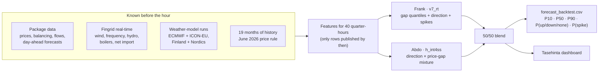

<div align="center">


**An imbalance-price forecast and situational view for Turku Energia**<br/>
Since AI 2026 hackathon · Turku · 6–8 November 2026


[**Results**](#-results) · [**How it works**](#-how-it-works) · [**Dashboard**](#-the-dashboard) · [**Submission**](#-submission) · [**Run it**](#-run-it) · [**Team**](#-team)

</div>

---

## ⚡ In one paragraph

A Turku Energia trader who misses their plan settles the difference at the **imbalance price**, which is set every 15 minutes and can jump far above or below the day-ahead (spot) price when the grid is short or in surplus. Every full hour, **Tasehinta** forecasts the next **40 quarter-hours**: the likely price, an 80 % range around it, which way the grid is likely to be balanced, and the risk of a price more than 50 €/MWh above or below spot. It does that by averaging two independently built LightGBM models, each trained on 19 months of data with the pre-June prices rebuilt under the June 2026 rule. The dashboard then shows only what is worth checking, explains why, and lets you replay any past hour exactly as it looked then.

## 📊 Results

The submitted forecast (½ Frank's `v7_rt` + ½ Abdo's `h_int4ss`), scored with the organisers' `score.py`. Lower is better.

<table>
<tr><th>Score (points)</th><th colspan="3">September · organisers' validation month</th><th colspan="3">August · second check</th></tr>
<tr><td></td><td>Baseline</td><td><b>Ours</b></td><td>Change</td><td>Baseline</td><td><b>Ours</b></td><td>Change</td></tr>
<tr><td>Median error, MAE €/MWh (30)</td><td>66.20</td><td><b>40.19</b></td><td>−39 %</td><td>38.67</td><td><b>27.05</b></td><td>−30 %</td></tr>
<tr><td>Uncertainty, pinball P10/P90 (20)</td><td>24.18</td><td><b>11.07</b></td><td>−54 %</td><td>11.65</td><td><b>6.22</b></td><td>−47 %</td></tr>
<tr><td>Exceptional prices, spike Brier (20)</td><td>0.1132</td><td><b>0.0840</b></td><td>−26 %</td><td>0.0792</td><td><b>0.0648</b></td><td>−18 %</td></tr>
<tr><td>Direction, Brier (10)</td><td>0.4509</td><td><b>0.3799</b></td><td>−16 %</td><td>0.4792</td><td><b>0.4202</b></td><td>−12 %</td></tr>
<tr><td><b>Weighted by the points</b></td><td></td><td colspan="2"><b>36.7 % better</b></td><td></td><td colspan="2"><b>29.0 % better</b></td></tr>
</table>

- **Every week of September** is better than the baseline, on all four scores.
- **The 80 % range is honest:** it holds the real price in 81 % of September's quarter-hours.
- **Each model was trained only on data published before its month started.** August's baseline is the organisers' own notebook code run on August.

<details>
<summary><b>How we got here: every change had to win both months</b></summary>

<br/>

| Step | What changed | September | August |
|---|---|---|---|
| Baseline | Organisers' `baseline.ipynb` | – | – |
| `v4_n50` | LightGBM, real-time grid data, weather-forecast revisions, Nordic wind for the median | 34.4 % | 23.7 % |
| `v6_hf` | + 15 months of pre-June history, prices rebuilt under the June 2026 rule | 35.7 % | 26.0 % |
| `v7_rt` | + real-time grid data on the history rows too | 35.7 % | 26.2 % |
| **Submitted** | ½ `v7_rt` + ½ Abdo's `h_int4ss` | **36.7 %** | **29.0 %** |

Tried and dropped because they lost one of the months: per-output blend weights, a third blend member, retuned trees, surplus/deficit series, spike-threshold distances, and more. The full log is in [`docs/RESULTS.md`](docs/RESULTS.md); every score is on the team scoreboard ([`scoreboard/`](scoreboard/)).

</details>

## 🧠 How it works



1. **Forecast the gap, not the price.** The day-ahead price is known the afternoon before, so both models forecast how far the imbalance price will land from it, then add it back.
2. **Direction drives everything.** With a surplus the price drops below spot; with a shortage it jumps above. The models forecast the balancing direction and the gap together, so price, range, direction and spike risk tell one consistent story.
3. **Only what was known.** Every input row is used only from its `first_usable_origin_utc`: real-time data 30 minutes or more after the quarter, weather runs 8 h (ECMWF) or 5 h (ICON-EU) after they start, prices 75 minutes later. Leakage tests guard it: [`tests/`](tests/).
4. **What moves it most:** the spot level, the latest gap to spot, wind in Sweden, the expected error of the day-ahead wind forecast, and grid frequency in the first hour.

<details>
<summary><b>The two halves in a little more detail</b></summary>

<br/>

| | Frank · `v7_rt` | Abdo · `h_int4ss` |
|---|---|---|
| Shape | Separate models for hours 1–2 (real-time grid) and hours 3–10 (weather); the median from a twin that also sees Nordic wind | A mixture: P(up/down/none) × the price gap in each direction |
| Training | Package + 15 months of pre-June history, one row per origin and quarter | Same history, its own features and calibration |
| Calibration | Last 28 days before the cutoff: Platt scaling for probabilities, quantile offsets per horizon band | Its own holdout calibration |
| Code | [`src/`](src/) on this branch | `experiments/lab/` on `brainstorming-abdo` |

Everything about the model: `model/README.md` on the [`deliverables`](https://github.com/Rdog69/turku-energy-since-ai/tree/deliverables) branch.

</details>

## 🖥️ The dashboard

**Tasehinta** turns the forecast into a situational view for a trader or a production shift supervisor (Level 2 of the challenge). It replays every forecast hour exactly as it was known at that hour.

| | |
|---|---|
| 🔎 **Glance first** | One sentence for the next 10 hours ("Low prices likely 07:00–09:00, 7 in 10 chance") and the few items worth checking |
| 📈 **One time axis** | Price with its 80 % range, balancing direction and spike risk (with the threshold lines and the change since an hour ago), all on the same 15-minute grid |
| ⏪ **Move through time** | Scroll or drag the graph in 15-minute steps, or use the period slider; nothing published after "now" is ever shown |
| 🧭 **Why and what to check** | Click any forecast quarter or alert: its drivers, strongest first, and a suggestion to review, never a trading instruction |
| ✅ **Hindsight** | How the forecast did over the last day, week or period, scored only on prices published by then |
| 🌍 **English / Suomi** | Language switch in the top right |

Run it locally:

```bash
python frontend/scripts/build_data.py      # builds frontend/public/payload.json from the submitted files
cd frontend && npx -y pnpm@9.15.9 install --frozen-lockfile && npx -y pnpm@9.15.9 dev
```

Needs Node 20.19+. The offline single file for demos, Windows notes and details: [`frontend/README.md`](frontend/README.md).

> [!IMPORTANT]
> The page contains licensed Nord Pool spot prices. `payload.json` and `bundle.html` are git-ignored. Show the dashboard from your own machine; don't host it.

## 📦 Submission

Due **Sunday 8 November 2026, 10:00**, through the Since AI platform. The full checklist, with the source of every requirement, is in [`deliverables/README.md`](deliverables/README.md). The documents themselves are on the [`deliverables`](https://github.com/Rdog69/turku-energy-since-ai/tree/deliverables) branch.

| Deliverable (brief §07) | Status | Where |
|---|---|---|
| Forecast file `forecast_backtest.csv`, validated | ✅ | [`submissions/blend_v7_rt_h_int4ss_test.csv`](submissions/), 26,920 rows, 0 errors; hash in [`MANIFEST.md`](submissions/MANIFEST.md) |
| Data sources, external services, models, software, licences | ✅ | `sources/SOURCES_AND_LICENCES.md` (deliverables branch), [`SOURCES.md`](SOURCES.md) |
| Situational view (Level 2) | ✅ | [`frontend/`](frontend/) |
| Source code and run instructions | ✅ | This README ([Run it](#-run-it)), `code/README.md` (deliverables branch) |
| Evaluation report | ✅ | `report/evaluation_report.md` (deliverables branch) |
| 5–8 slides · demo video ≤ 5 min | ⏳ | In progress |

## 🚀 Run it

```bash
python -m venv .venv && . .venv/bin/activate      # Windows: .venv\Scripts\activate
pip install -r requirements.txt
python -m pytest                                  # leakage tests: must all pass
```

Unzip the organisers' starter package into `starter_package/` (git-ignored; it holds licensed spot data). Then:

```bash
# our half: train on everything up to 4 Oct, forecast the 673 test origins, validate
python -m src.backtest.run --model v7_rt --period test
# the validation month, scored with the organisers' score.py
python -m src.backtest.run --model v7_rt --period validation
# the submitted blend from the two halves (Abdo's file comes from his branch)
python -I submissions/tools/blend_period.py . v7_rt test submissions/forecast_backtest_h_int4ss.csv blend_v7_rt_h_int4ss
```

Abdo's half and the full run order for both: `code/README.md` on the deliverables branch. Pre-June history and external data: [`SOURCES.md`](SOURCES.md).

<details>
<summary><b>Repository map</b></summary>

<br/>

```
.
├─ src/                 our model: data loading + availability rule, features, models, backtest
├─ tests/               leakage and format tests (pytest)
├─ submissions/         final forecast files, their hashes (MANIFEST.md) and the blend tools
├─ frontend/            the Tasehinta dashboard (React + Vite)
├─ deliverables/        submission checklist
├─ scoreboard/          the team's shared score log
├─ docs/                results log, plan, development README, logo
├─ external_data/       open data we downloaded (Fingrid real-time, weather runs; CC BY 4.0)
├─ SOURCES.md           every data source and its licence
└─ QUESTIONS.md         questions to the organisers and their answers
```

</details>

## 📜 Data, rules and licences

- **Starter package** (Fingrid, ENTSO-E, Nord Pool, calendar), plus Fingrid's open real-time API, Open-Meteo weather runs (CC BY 4.0), OpenStreetMap turbines (ODbL) and Elering's 2025 spot prices: [`SOURCES.md`](SOURCES.md).
- **Nord Pool spot prices** are licensed to Turku Energia for the hackathon only. They are never committed, the repository is private, and the data is deleted after the event.
- **Questions to the organisers** and their answers (pre-June data, corrected Fingrid history): [`QUESTIONS.md`](QUESTIONS.md).
- **AI tools:** we used Claude Code for coding and analysis, and Featherless-hosted open LLMs for the written briefings in an earlier dashboard. Listed in the sources document.

## 👥 Team

| | Main work |
|---|---|
| **Frank** | `v7_rt` model, blend and submission files, team scoreboard, dashboard design |
| **Abdo** | `h_int4ss` history model, the history dataset, dashboard (`front-end`), deliverables and report |
| **Jim** | Evaluation framework, explanations and alerts, API, slides and video drafts |
| **Pavlo** | Data map, ICON-EU weather features, leakage review, sources |
| **Pavel** | Model audits, tuning trials, questions to the data providers |

<div align="center">


</div>
