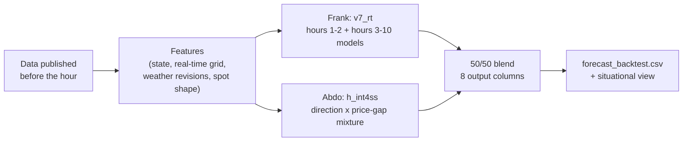

# The submitted model: everything about it

The reference for the report, the slides and the demo video. All numbers are from the organisers' validation month (7 Sep – 4 Oct 2026) or the August check month, scored with the organisers' `score.py`.

---

## 1. In 30 seconds

> Every full hour, we forecast the Finnish imbalance price for the next 10 hours, quarter by quarter. The day-ahead price is already known, so we forecast the **gap** to it: will the grid need up- or down-regulation, how far will the price move, and how sure are we? Two separately built LightGBM models, one by Frank and one by Abdo, each trained on 19 months of data with the pre-June prices rebuilt under the June 2026 pricing rule, are averaged 50/50. On the organisers' validation month the forecast misses by **40 €/MWh** on average, where the baseline misses by 66, and it is **36.7 % better than the baseline** on the challenge's points.

## 2. Key numbers

**Organisers' validation month (7 Sep – 4 Oct 2026):**

| Score | Our forecast | Baseline | Change |
|---|---|---|---|
| MAE (median) | **40.19 €/MWh** | 66.20 | −39 % |
| Pinball p10/p90 (uncertainty) | **11.07** | 24.18 | −54 % |
| Spike Brier (exceptional prices) | **0.0840** | 0.1132 | −26 % |
| Direction Brier | **0.3799** | 0.4509 | −16 % |
| **Points-weighted vs baseline** | **36.7 % better** | | |

**August, trained only on data before 1 August:** 27.05 / 6.22 / 0.0648 / 0.4202, 29.0 % better than the baseline (38.67 / 11.65 / 0.0792 / 0.4792).

**More facts from September:**

| | Value |
|---|---|
| Better than the baseline | In **every week** (MAE 47.6 vs 84.7; 37.8 vs 61.4; 44.9 vs 68.8; 30.1 vs 49.4) |
| Error by horizon | Next hour **35.4** (baseline 51.7); hour 2 **38.9** (57.1); hours 3–4 **40.1** (63.5); hours 5–10 **41.2** (71.1) |
| Better than assuming "price = day-ahead price" | 40.2 vs 46.6 €/MWh |
| P10–P90 band covers the real price | **81.4 %** of quarters (target about 80 %); average width 103 €/MWh |
| Most likely direction correct | 72 % of quarters (always guessing "down", the commonest state, gets 66 %) |
| Spike warnings that came true | 46 % of quarters flagged ≥ 40 % high-price risk did spike, against 12 % of all quarters. 56 % of those flagged ≥ 50 % low-price risk did, against 13 % |

## 3. The problem the model solves

- **How the price works:** the imbalance price is settled per 15 minutes.
  - With no dominant balancing direction it equals the **day-ahead (spot) price**.
  - When Finland is **short** of power (up-regulation), it is pushed **above** spot; when there is a **surplus** (down-regulation), **below**.
  - Since 1 June 2026 it is the **volume-weighted average** of the mFRR and aFRR energy prices in the dominant direction.
- **What a Turku Energia trader needs, for each coming quarter-hour:**
  - the likely price (median);
  - its uncertainty (P10–P90);
  - the direction of balancing (up, down, none);
  - the risk of an exceptional price, more than 50 €/MWh above or below spot.

## 4. How a forecast is made, every hour

1. **Collect what was published before the hour** (`first_usable_origin_utc` ≤ the forecast hour):
   - the latest imbalance prices and directions (about 75 minutes old);
   - real-time grid data (30 minutes or more old);
   - the newest weather-model runs (5–8 hours old);
   - the day-ahead prices for all 40 quarters (known since the afternoon before).
2. **Build features** for each of the 40 quarters ahead (sections 6 and 7).
3. **Each model predicts:**
   - the gap's distribution (P10, P50, P90);
   - P(up), P(down) and P(none);
   - P(gap > +50) and P(gap < −50).
4. **Calibrate** with the last weeks before the forecast period.
5. **Average the two models**, add the day-ahead price back, and write the 40 rows.

## 5. The data

| Source | What | Published | Used by |
|---|---|---|---|
| Starter package: Fingrid | Imbalance price (target), mFRR direction, mFRR/aFRR prices and volumes, consumption, production, cross-border flows (SE1, SE3, Norway, Estonia), day-ahead wind/solar/consumption forecasts | As given per row | Both |
| Starter package: ENTSO-E | Neighbour imbalance prices (SE1, SE3, Estonia), transmission capacity FI–EE, neighbour load forecasts | As given per row (about 2.6 h after the quarter) | Frank (imbalance prices, FI–EE capacity) |
| Starter package: Nord Pool | Finnish day-ahead price | D-1 14:00 Finnish time | Both |
| Starter package: calendar | Hour, weekday, holidays, daylight saving | Always | Both |
| Fingrid Open Data, real time (3-minute data) | Surplus/deficit (198, 186), measured wind (181), frequency (177), nuclear, hydro, electric boilers, CHP, net import, cross-border flows | Quarter end + 30 min, rounded up to the hour | Both (Frank: hours 1–2 model) |
| Fingrid Open Data, history | The package's series for Mar 2025 – May 2026; aFRR activated volumes (349/350) | Same rules as the package | Both (training only) |
| Elering (Nord Pool feed) | Finnish day-ahead prices before June 2026 | D-1 14:00 | Both (training only) |
| Open-Meteo Single Runs | ECMWF IFS and DWD ICON-EU forecast runs at wind-farm locations, Nordic points | Run time + 8 h (IFS), + 5 h (ICON), measured | Frank (both), Abdo (IFS) |
| OpenStreetMap | Wind-turbine locations | Static | Frank (capacity weights) |

**Not used:**
- Swedish or Estonian **day-ahead** prices (only the Finnish one).
- Real-time mFRR prices or last-bid prices (not cleared with the organisers).

## 6. The pre-June history and the June 2026 price rule

**Why:** the starter package begins on 1 June 2026, so a model trained on it alone sees four summer months. The organisers confirmed that earlier data may be used. The cutoff exists only because the price rule changed.

**The problem:** before June, the price in an up-regulated quarter was the **maximum** of the mFRR and aFRR prices, and the minimum when down-regulated. Since June it is their **volume-weighted average**. Training on old prices would teach the model the wrong formula.

**What we did:**
1. Downloaded the package's Fingrid series back to March 2025 (same dataset ids, identical to the package where they overlap) and the aFRR activated volumes.
2. Recomputed every pre-June imbalance price with the **June rule**: the volume-weighted average of mFRR and aFRR when both act in the dominant direction, otherwise the mFRR price; the spot price when there is no direction.
3. Checked the rebuild on Jun–Oct 2026, where the official price is known: it matches on **99.5 % of quarters** (MAE 0.09 €/MWh). The old rule would give 5.45.
4. Added the Finnish day-ahead prices from Elering's Nord Pool feed (identical to the package on all 14,824 overlapping quarters).
5. Added market-era flags:
   - **15-minute day-ahead products** from 1 Oct 2025 (hourly before);
   - the **June 2026 rule**, so the model can tell eras apart.

**Result:** training on Mar 2025 – Oct 2026 improved **both** models in **both** check months, most of all the uncertainty band. Frank's pinball improved by about 6 %. Abdo's August pinball improved from 6.59 to 6.16 and September MAE from 41.37 to 40.51.

## 7. Model 1: Frank's `v7_rt`

**Architecture:**
- **Two horizon models:**
  - **hours 1–2** (steps 1–8), which also sees fresh real-time grid data;
  - **hours 3–10** (steps 9–40), without it, because real-time data turns into noise after about two hours.
- **The median from a twin:** the P50 comes from an identical model that also sees **Nordic wind** (Sweden, Norway, Denmark, Estonia). That helped the median but not the band, so the band and the probabilities come from the model without it.
- **What each model predicts** (LightGBM):
  - the gap's P10/P50/P90 (quantile regression);
  - P(up-regulation);
  - spike probabilities as **P(direction) × P(|gap| > 50 | direction)**, consistent with the direction by construction.
- **Tree settings:** small, slow-learning trees, chosen on training-only folds:
  - 15 leaves, at least 800 rows per leaf;
  - learning rate 0.03, 300 trees;
  - 60 % of features per tree.
- **5 seeds**, averaged.
- **Calibration on the last 28 days before the forecast period:**
  - Platt scaling for the probabilities;
  - offsets for the band;
  - spike maps shrunk toward "no change" when those days held few spikes (m0 = 50), so a quiet month cannot switch spike warnings off.
- **History:** every 3rd hourly origin before June (neighbouring origins overlap heavily), including the real-time series.

**Inputs:**

| Group | Features |
|---|---|
| Known a day ahead | Spot price, spot ramps into and out of the quarter, spot relative to the 10-hour average, day-ahead wind / solar / consumption / residual-load forecasts, wind ramp, wind share, FI–EE transmission capacities, hour, weekday, holiday, daylight saving, quarter of the hour |
| Recent state | Latest gap to spot and direction, their 1-, 2- and 4-hour averages, latest mFRR up/down volumes, consumption-forecast error, flows with SE1 / SE3 / Norway / Estonia, **latest SE1, SE3 and Estonian imbalance prices relative to spot**, age of the newest price |
| Grid right now (hours 1–2) | Wind against its forecast (now and last hour), consumption error, frequency deviation (now and last hour), nuclear and its 6-hour change, hydro, electric boilers, net import, flows to SE3 and Estonia and their 1-hour changes, CHP change |
| Weather revisions (ECMWF) | Wind index at 14 wind-farm points **weighted by installed capacity** (OpenStreetMap turbines); its revision since the day-ahead forecast's run; revision in MW; wind speed; temperature; icing risk |
| Second weather model (ICON-EU) | ICON wind index, its revision, and how far it disagrees with ECMWF |
| Learned wind production | Wind power predicted from all 22 weather points, with weights fitted to Fingrid's measured output on training data only; its gap to the day-ahead forecast and its revision |
| Nordic wind (median twin only) | ECMWF wind index and revision in Sweden, Norway, Denmark and Estonia |
| History flag | Which pricing rule a row was settled under |

## 8. Model 2: Abdo's `h_int4ss`

**Architecture: a direction × price-gap mixture.**
1. A classifier gives **P(up)** versus P(down). P(none) is its share in training (under 1 %).
2. Two sets of quantile models give the gap's distribution **if up** and **if down**, 13 quantiles each (2 % … 98 %).
3. The forecast distribution = P(up) × (gap if up) + P(down) × (gap if down) + P(none) × (no gap). **Every output is read from this one distribution:**
   - P10/P50/P90;
   - P(gap > +50) for the high-price risk, P(gap < −50) for the low-price risk;
   - so the band, the spikes and the direction always agree.

**Settings:**
- **Horizon models:** separate models for steps 1–4, 5–8 and 9–16, and one for the rest.
- **LightGBM:** 7 leaves, at least 300 rows per leaf, 350 trees, learning rate 0.04, 80 % row and feature subsampling, 3 seeds.
- **Calibration on the last 14 days before the forecast period:**
  - per horizon band, a width factor for P10 and P90 (minimising pinball);
  - Platt maps for the spike and direction probabilities;
  - everything shrunk toward "no change" when evidence is thin (m0 = 50).
- **Smoothing:** a light blend with the previous hour's forecast for the same quarters (weight 0.2), so forecasts don't jump hour to hour.
- **Training:** every hourly origin from Mar 2025 to the cutoff. Labels from the last 2 hours before the cutoff are left out, because those prices were not yet published.

**Inputs (117 features):**

| Group (count) | Features |
|---|---|
| Package (35) | Step, hour, weekday, holiday; spot, spot change to the previous and next quarter, spot relative to the origin and to the 10-hour window; day-ahead wind, consumption, solar, net load and their 4-quarter changes; latest gap and its 1- and 4-hour averages, age of the newest price; latest direction and its 2-hour average; latest mFRR up/down volumes and 1-hour averages; latest mFRR up/down prices; consumption and production-plan errors; flows with SE1 / SE3 / Estonia; distance of the latest mFRR prices to the spike thresholds; up/down price spreads |
| Real-time imbalance (12) | Fingrid surplus/deficit (198): latest four values, 1-, 2- and 4-hour means, trend, mean size, variability; cumulative (186) and its change |
| Real-time wind (9) | Measured wind minus the day-ahead forecast (now, 1 h, 2 h, trend, relative); measured wind now; wind-error carry-over to the delivery quarter |
| Real-time grid (9) | Frequency (177) now and 1-hour mean, nuclear drop and change, net import and change, hydro change, FI–SE imbalance power |
| Direction runs (14) | Length of the current up/down run and the previous one, switches in 4 h, up-share over 2 / 8 / 24 h, high/low spike shares over 4 and 24 h, largest/smallest gap in 4 h, the same quarter yesterday, up-share in the same quarter over 7 days |
| Direction history (19) | Signed run length, up-shares 1–24 h, spike shares, gap extremes, yesterday's direction and gap, 7-day same-quarter shares |
| Wind-error estimate (1) | Combined estimate of the day-ahead wind forecast's error from the newest ECMWF run's revision, the measured wind error and ECMWF's now-cast |
| Spot shape (8) | The quarter's rank in the day, distance to the day's maximum and minimum, the day's spread, ramps into and out of the quarter |
| Market era (2) | 15-minute day-ahead products (since 1 Oct 2025); the June 2026 price rule |

## 9. The blend

- **Weights:** equal, **½ `v7_rt` + ½ `h_int4ss`**, on all eight columns (P10, P50, P90, P(up), P(down), P(none), P(high spike), P(low spike)).
- **Consistency fixes:**
  - the quantiles are re-sorted;
  - the direction probabilities renormalised to sum to 1;
  - the two spike probabilities capped so they sum to at most 1.
- **`data_cutoff_utc`:** the later of the two models' (always before the forecast hour).
- **`top_drivers`:** from `v7_rt`'s TreeSHAP contributions.

**Why 50/50, and why these two:**
- The models were built independently, with different feature sets, horizon splits and calibration windows, so their errors only partly overlap.
- In September the blend beats both members on all four scores. Over both months it is the best of the three: 32.8 % better than the baseline on average, against 32.4 % for `h_int4ss` and 30.9 % for `v7_rt`.
- Fitted weights per output were tried with cross-fitting (fit on one month, check on the other). They did not beat 50/50 in both months.
- A P90 stretch (×1.15) and a spike cap gained about 0.2 points on the same two months, but pushed band coverage to 84–85 % (target 80 %). We kept the simpler blend.

## 10. What drives the forecast

From the `top_drivers` column (TreeSHAP) over September:

| | Leading drivers |
|---|---|
| **Next 2 hours** | Spot level (first driver in 45 % of quarters), **latest published gap** (34 %), **grid frequency over the last hour** (9 %), spot vs the 10-hour average. The market's current state carries forward |
| **Hours 3–10** | Spot level (72 %), then the gap over the last hour, **wind in Sweden**, the **expected error of the day-ahead wind forecast**, the latest gap |
| **Overall, share in the top 3** | Spot level 78 %, gap last hour 44 %, latest gap 36 %, **wind in Sweden 32 %**, expected wind-forecast error 16 %, ICON wind revision 14 %, gap last 4 h 11 % |

**The story behind it:**
- **Momentum near term:** an up-regulated hour is usually followed by another, and grid frequency shows a shortfall live.
- **Price level:** high day-ahead prices go with larger gaps in either direction.
- **Wind surprises:** when the newest weather runs cut the wind forecast after the day-ahead market closed, Finland ends up short, so up-regulation and higher prices follow.
- **Swedish wind:** Finland trades heavily with SE1/SE3, so Swedish wind matters too.

## 11. Two moments to show (September, the validation month)

- **Mon 21 Sep 2026, 19:00:** high-price risk.
  - **The forecast:** **70 %** risk that the 20:00 quarter would end far above spot.
  - **What happened:** the imbalance price hit **730 €/MWh**, against a day-ahead price of 36.
  - **Drivers:** grid frequency over the last hour, the latest gap, hydro.
- **Mon 14 Sep 2026, 19:00:** low-price risk 3.5 hours ahead.
  - **The forecast:** **64 %** risk for 22:30.
  - **What happened:** the price was **−5 €/MWh**, against a day-ahead price of 258.
  - **Drivers:** the high spot level, spot against its 10-hour average, the gap over the last 2 hours.
- **Plenty more:** in September there were 71 cases where a spike was flagged at 60 % or more, 1–4 hours ahead, and it happened.

## 12. No future data

- **Publication times:** every input row is used only from its `first_usable_origin_utc`. External sources have conservative, documented publication delays, rounded up to the next full hour:
  - real-time data: quarter end + 30 min;
  - weather runs: run time + 8 h (IFS) or + 5 h (ICON), measured;
  - day-ahead prices: D-1 14:00.
- **Automated leak tests in both pipelines:** they rebuild every feature for random forecast hours with all not-yet-published rows deleted and require identical values. Features, targets and the price are kept apart.
- **Training cutoffs:** each check month is trained only on data published before it starts. Labels whose prices were not yet published at the cutoff are left out.

## 13. How we avoided fooling ourselves

- **Two check months:** every change had to improve **both** September (the organisers' validation) and August (trained on June–July only), and most of the weeks within them.
- **About 300 experiments** are logged with their scores (`docs/EXPERIMENTS.md` on `brainstorming-abdo`, `docs/RESULTS.md` on `brainstorming-frank`). A shared team scoreboard scores every model with the organisers' script.
- **Rejected after testing on both months:**
  - recency weighting;
  - bigger trees;
  - realised-volatility features;
  - online self-recalibration from recent errors;
  - outage messages (UMM);
  - Estonian and Danish system data;
  - FMI station observations;
  - direction-run features in Frank's model;
  - a third blend member;
  - per-output blend weights.

## 14. Limitations

- **Rare event days dominate the error.** In September, three days carried about a third of the MAE. The band and the spike risk are where the forecast says "this could go far"; the median will miss them.
- **High-price spikes are hard to call far ahead.** About one in five high-price quarters is flagged at ≥ 40 % in advance, and when it is, almost half of the flags come true (against a 12 % base rate).
- **The heating season** is only beginning in the training data.
- **Open data cannot see Turku Energia's own position or plants.** The situational view therefore says "check this situation", never "trade this".

## 15. For the demo video

**The pitch (one sentence):**
> "We forecast how far Finland's imbalance price will move from the day-ahead price in the next 10 hours, and how sure we are, using only data published before each hour."

**Five talking points:**
1. **"Forecast the gap, not the price."** The day-ahead price is known; the uncertainty is the balancing direction and how far the price jumps.
2. **"Direction first."** Up-regulation pushes the price above spot, down-regulation below. Our forecast is a mix of the two, so the price, band, spike risk and direction always agree.
3. **"19 months of data, made comparable."** We rebuilt the pre-June prices with the June 2026 rule, 99.5 % exact where we can check it.
4. **"Two independent models, averaged."** Different features and horizons; the blend beats both.
5. **"Nothing from the future."** Every number on screen was published before the hour, and the leak tests prove it.

**On screen, in order:**
1. The Overview at a calm hour: "prices close to day-ahead, down-regulation likely".
2. Scroll to **Mon 21 Sep, 19:00**: the high-price warning for 20:00 and its drivers (frequency, latest gap). Then scroll forward in 15-minute steps and watch the 730 €/MWh price appear.
3. Mon 14 Sep evening: the low-price warning, and the price going negative while the day-ahead price was 258.
4. The 15-minute rows: balancing direction and spike risk. Click a quarter for its details and drivers.
5. Hindsight: our error against the day-ahead price and the baseline, week by week.

**Key numbers to say out loud:**
- 40 €/MWh average error, against 66 for the baseline (−39 %);
- 36.7 % better on the challenge's points;
- better in every week of September;
- the uncertainty band holds the real price 81 % of the time (target 80 %).
