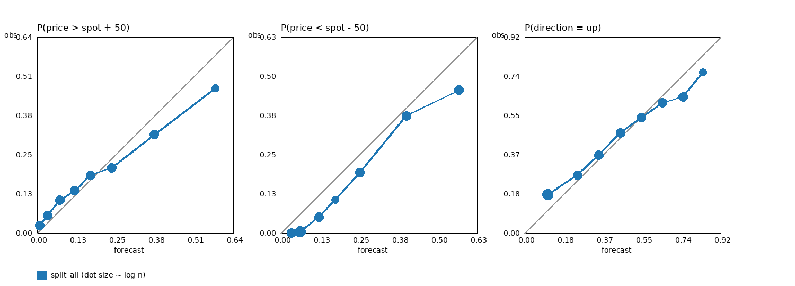

# Reliability check of the probabilities (validation period, 7 Sep - 4 Oct 2026)

> Analyses `split_all` on the validation period (7 Sep – 4 Oct 2026), written before the merge. The pipeline model is now `v6_hf`; the numbers below are not its probabilities.

Quarter-hours are binned by forecast probability (all 40 steps pooled); `pred` is the mean forecast in the bin, `obs` the observed frequency, `n` the number of rows. A calibrated model has obs close to pred. Rows within a bin are strongly autocorrelated (10 hourly origins forecast each quarter-hour), so the effective sample is much smaller than `n`.

## split_all

### P(price > spot + 50) (`p_spike_high`), Brier 0.0976, mean pred 0.114 vs observed 0.121

| pred | obs | obs - pred | n |
|---|---|---|---|
| 0.009 | 0.024 | +0.015 | 6520 |
| 0.034 | 0.058 | +0.024 | 4751 |
| 0.073 | 0.106 | +0.033 | 5067 |
| 0.123 | 0.137 | +0.015 | 3187 |
| 0.173 | 0.188 | +0.014 | 2078 |
| 0.244 | 0.212 | -0.031 | 2499 |
| 0.381 | 0.320 | -0.062 | 2065 |
| 0.579 | 0.471 | -0.108 | 533 |

### P(price < spot - 50) (`p_spike_low`), Brier 0.0866, mean pred 0.183 vs observed 0.130

| pred | obs | obs - pred | n |
|---|---|---|---|
| 0.033 | 0.000 | -0.033 | 2224 |
| 0.062 | 0.005 | -0.058 | 12836 |
| 0.122 | 0.051 | -0.071 | 1510 |
| 0.174 | 0.105 | -0.068 | 968 |
| 0.251 | 0.193 | -0.059 | 1888 |
| 0.401 | 0.374 | -0.026 | 5615 |
| 0.569 | 0.456 | -0.113 | 1659 |

### P(direction = up) (`p_up`), Brier 0.1988, mean pred 0.308 vs observed 0.336

| pred | obs | obs - pred | n |
|---|---|---|---|
| 0.109 | 0.180 | +0.072 | 10433 |
| 0.248 | 0.272 | +0.024 | 4460 |
| 0.348 | 0.367 | +0.019 | 3534 |
| 0.450 | 0.471 | +0.022 | 2821 |
| 0.548 | 0.542 | -0.006 | 2268 |
| 0.647 | 0.611 | -0.036 | 1706 |
| 0.744 | 0.640 | -0.104 | 1095 |
| 0.838 | 0.755 | -0.083 | 383 |

## Reading

- **High spikes**: close to calibrated, slightly under-confident at the low end (forecast 0.01-0.07, observed 0.02-0.11) and over-confident at the top (forecast 0.58, observed 0.47). Mean forecast 0.114 vs observed 0.121.
- **Low spikes**: over-forecast across the whole range (mean forecast 0.183 vs observed 0.130). Forecasts of 0.03-0.12 almost never happened (observed 0.00-0.05), and the 0.57 bin realised 0.46. The probabilities are over-confident, so low-spike Brier (0.0866) leaves room.
- **Direction (p_up)**: reliable in the middle, but over-confident at both ends. Forecast 0.11 realised 0.18, and forecasts of 0.74 and 0.84 realised 0.64 and 0.76. Shrinking the extremes would help a little.
- Bins are strongly autocorrelated (each quarter-hour is forecast from 10 hourly origins), so deviations of a few points in the thin bins are not significant.
- Only split_all is plotted. A second series for pooled calibration (split_all_pcal) can be added with the same script once its validation forecast exists.
